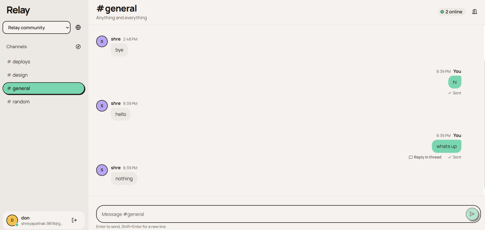

# Relay

A self-owned, real-time community chat app with channels, threads, presence, typing indicators,
reliable delivery and recoverable connections. It's built to run as a personal project on Vercel
(Hobby) with Neon Postgres and Upstash Redis.



- **Frontend:** React 19, Vite 7, Tailwind 4, React Router 7, react-virtuoso, Zustand, Radix Dialog,
  and lucide icons.
- **Backend:** Node.js 22 and TypeScript on Vercel Functions, with `ws` WebSockets, Drizzle ORM on
  Postgres, ioredis pub/sub, Zod, jose JWTs and bcrypt.
- **Repo:** pnpm workspaces containing `apps/web`, `packages/server`, `packages/shared` and `api/` (the
  Vercel functions).

## Quick start (local)

Requires Node 22+, pnpm 9, and Docker (or your own Postgres 16 and Redis).

```bash
pnpm install
docker compose up -d
cp .env.example .env
pnpm db:setup        # migrate + seed #general #design #deploys #random
pnpm dev             # app http://localhost:5173  (API/WS proxied to :3001)
```

`pnpm dev` applies pending database migrations and runs the idempotent seed before starting the servers.
If database preparation fails, startup stops so the app cannot run against an outdated schema.

Open the app in two browser windows, create two accounts, and chat.

New accounts can chat immediately in the default public community. Use **Discover communities**
to join another public community without approval, and the community switcher to move between them.
Private communities require an invitation. Each community has its own channels, owners and members.

The first account is the **Superadmin** and owns the default community. **Manage communities** lets
the superadmin create public/private communities, assign or replace their owners, suspend communities,
and suspend accounts across the platform. An assigned owner must already have an active account.
Superadmin access does not automatically grant access to private community conversations.

Community owners use **Create channel**, **Invite people**, and **Members and channels**.
The **Access** action on a channel adds or removes selected members, including for private channels.
Blocking a member affects only that community; **Restore** returns their access to its default channels.
Invitations require a private, single-use link and the matching signed-in email. New users can sign up
from the link and then accept it. Links expire after seven days; share them manually because no email
is sent. **New link** replaces a previous invitation link. Previously created pending invitations need
a new link after the secure-invitation migration; existing memberships and message history are preserved.

Run `pnpm db:migrate` before using communities on an existing database. The migration preserves
channels and history in **Relay community**, preserves its owners and community blocks, and activates
pending accounts. The earliest existing owner becomes superadmin (or the oldest account if none exists).
Default channels seed once, so deleting one persists across subsequent deployments.

The deployment remains Vercel Hobby + Neon Free + Upstash Free, with no new services or paid plans.
Vercel Hobby is for personal, non-commercial use; free-tier usage limits still apply. See deployment docs.

## Scripts

| Command | Does |
| --- | --- |
| `pnpm dev` | API/WebSocket server (watch) + Vite dev server |
| `pnpm build` | Build shared, server and web |
| `pnpm lint` / `pnpm typecheck` | ESLint / TypeScript across the repo |
| `pnpm test` | Unit tests (no services needed) |
| `pnpm test:integration` | Server tests against real Postgres + Redis, two instances |
| `pnpm test:e2e` | Playwright, desktop + mobile (run `pnpm build` first) |
| `pnpm db:generate` / `db:migrate` / `db:seed` / `db:setup` | Drizzle migrations and idempotent seed |
| `k6 run load/k6-chat.js` | Load test; see `docs/TESTING.md` |

## Environment

All variables are documented in [`.env.example`](.env.example). The server validates them at startup;
if any are missing, the app shows a setup screen naming them (values are never shown).

| Variable | Required | Purpose |
| --- | --- | --- |
| `DATABASE_URL` | yes | Postgres (Neon pooled URL in production) |
| `REDIS_URL` | yes* | Upstash TCP URL `rediss://…` (*local single-process dev may set `RELAY_ALLOW_MEMORY_BUS=1` instead) |
| `AUTH_SECRET` | yes | ≥ 32 chars, signs access tokens |
| `APP_URL` | yes | Public origin; trusted for CSRF and WebSocket origin checks |
| `TRUSTED_ORIGINS` | no | Extra allowed origins |
| `WS_MAX_CONNECTION_MS` | no | Server-side socket lifetime (default 290000, under Hobby's 300 s) |

## Docs

- [Architecture](docs/ARCHITECTURE.md): message flow, delivery semantics, reconnection, presence, data
  model, Redis budget.
- [Deployment](docs/DEPLOYMENT.md): Vercel, Neon and Upstash setup, free-tier limits, and what's still
  unverified.
- [Security](docs/SECURITY.md)
- [Testing](docs/TESTING.md): how to run each suite and the recorded results.

## Known limitations

- **Vercel deployment not yet tested end to end.** The `api/` contract matches Vercel's current docs.
  Monorepo bundling, the REST rewrite and real latency still need a first deploy to confirm; see
  `docs/DEPLOYMENT.md`.
- **Connection lifetime:** Hobby closes every WebSocket within 300 s. Relay reconnects
  make-before-break and resyncs by sequence number, but every connection still churns every few
  minutes.
- **Rate limits are per function instance,** not global. Use Vercel Firewall rules for global limits.
- **Performance targets:** the brief's targets (p95 < 80 ms, 50k messages/min, 5,000+ users) are
  unmeasured on Vercel, and p95 latency missed 80 ms in the local single-CPU test.
- **Missing features:** no message editing or deletion, no file uploads, and no Storybook
  (components live in `apps/web/src/components/ui`).
- **Avatars:** new users get lavender or amber avatars only.

## License

Copyright (c) 2026 Shreya Pathak. All rights reserved. This code is shared for viewing only; it may
not be copied, modified, redistributed or deployed without written permission. See `LICENSE`.
